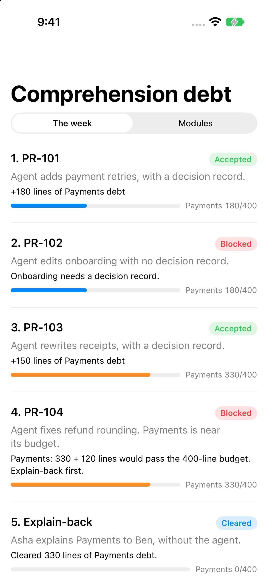
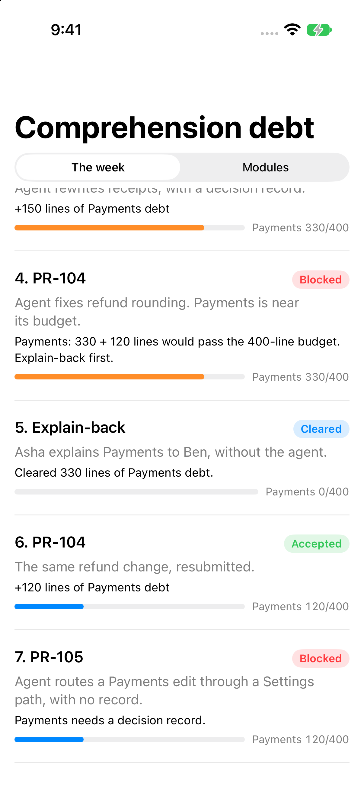
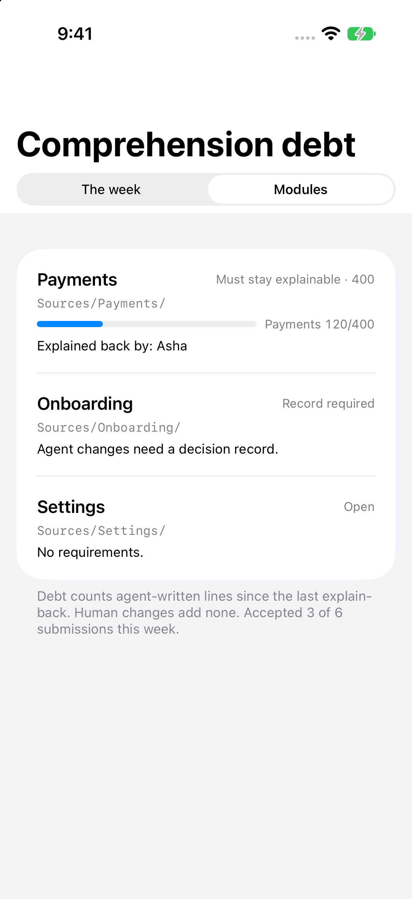

# ComprehensionLedger

A small Swift package that meters **comprehension debt** ([Addy Osmani's term](https://addyosmani.com/blog/comprehension-debt/)): here, the agent-written code in a module that nobody has explained back since it landed. It gates agent-written changes by module tier and clears a module's debt only after a logged explain-back to a witness other than the explainer.

Article: (added after publish)

  

## The rule

Every module gets one tier:

| Tier | Agent-written changes need | Debt |
|---|---|---|
| `.open` | nothing | none |
| `.recordRequired` | a decision record: problem, choice, and at least one rejected alternative with a reason | none |
| `.mustStayExplainable(debtBudget:)` | the same record plus at least one invariant | every agent-written line adds to the module's debt; a change that would take it past the budget is blocked until a logged explain-back resets it to 0 |

Human-written changes need no record and add no debt. They don't clear debt either; only an explain-back does. A change is judged as a whole: if any module blocks it, nothing is applied. A change larger than the whole budget is blocked with `.changeLargerThanBudget`, because no explain-back can make room for it.

Paths are resolved before matching (`.` and `..`, repeated slashes), so `Sources/Settings/../Payments/Refund.swift` is governed as Payments. Absolute paths, backslashes and paths that climb above the repository root are blocked. Prefixes match on directory boundaries (`Sources/PaymentsUI` is not inside `Sources/Payments`), ignore case (like the default macOS file system), and the longest prefix wins. Paths that match no rule are not governed.

An accepted change ID can't be submitted again (`.duplicateChange`), so its lines can't be counted twice. Line counts that would overflow `Int` block the change (`.lineCountOverflow`) instead of crashing.

`recordExplainBack(_:)` matches the module name ignoring case and needs a non-blank explainer, witness and summary, a witness who isn't the explainer, and neither name may match an agent that has submitted a change to this ledger (`.agentAsParticipant`). Accepted explain-backs are logged in `history` with their summary; refused ones throw and are logged as `.explainBackRejected`.

```swift
import ComprehensionLedger

var ledger = try ComprehensionLedger(rules: [
    ModuleRule(name: "Payments", pathPrefix: "Sources/Payments",
               tier: .mustStayExplainable(debtBudget: 400)),
    ModuleRule(name: "Onboarding", pathPrefix: "Sources/Onboarding", tier: .recordRequired),
    ModuleRule(name: "Settings", pathPrefix: "Sources/Settings", tier: .open),
])

let verdict = ledger.submit(Change(
    id: "PR-104",
    author: .agent(name: "Claude Code", drivenBy: "Asha"),
    files: [FileDiff(path: "Sources/Payments/Refund.swift", linesChanged: 120)],
    record: refundRecord  // a complete DecisionRecord with an invariant
))
// With 330 lines of debt already:
// .blocked([.explainBackRequired(module: "Payments", debt: 330, incoming: 120, budget: 400)])

try ledger.recordExplainBack(ExplainBack(
    module: "Payments", explainer: "Asha", witness: "Ben",
    summary: "Retries reuse one key; receipts come from the charge, not the cart."
))
// Returns 330 (lines cleared). The same change is now accepted.
```

`evaluate(_:)` judges a change without changing the ledger; `submit(_:)` judges it and applies the debt if accepted. Every accepted change, blocked change and explain-back is appended to `history`.

## The scripted week

`SampleScenario` is the week the demo app plays. `SampleScenarioTests` pins every outcome:

| Step | What happens | Verdict | Payments debt |
|---|---|---|---|
| 1. PR-101 | agent adds payment retries, 180 lines, with a record | accepted | 180 / 400 |
| 2. PR-102 | agent edits onboarding, no record | blocked: missing record | 180 / 400 |
| 3. PR-103 | agent rewrites receipts, 150 lines, with a record | accepted | 330 / 400 |
| 4. PR-104 | agent fixes refund rounding, 120 lines, with a record | blocked: explain-back required | 330 / 400 |
| 5. Explain-back | Asha explains Payments to Ben, without the agent | 330 lines cleared | 0 / 400 |
| 6. PR-104 | the same change, resubmitted | accepted | 120 / 400 |
| 7. PR-105 | agent edits `Sources/Settings/../Payments/Refund.swift`, no record | blocked: missing record (Payments) | 120 / 400 |

## How to run it

1. `git clone https://github.com/rajatslakhina/comprehension-debt-article-demo.git && cd comprehension-debt-article-demo`
2. Open `Demo.xcodeproj` in Xcode.
3. Pick an iPhone Simulator and press Build & Run.

No other setup. The app uses the package through a local package reference in the same repo. Launch arguments `-screen week`, `-screen modules` and `-scrollToEnd YES` choose the screen.

Library only: `swift build` and `swift test`. The package targets iOS 17+ / macOS 14+ with Swift tools 5.9; it was verified with Xcode 27.2 locally and CI uses the default Xcode on GitHub's macos-15 image.

## Honest limits

- It's an in-memory library. Until you wire it into CI or a merge queue, it gates nothing; persisting it is up to you.
- Lines changed are a crude proxy for how much understanding a change needs, and only agent-written lines are metered. Human code nobody understands any more is invisible to it.
- Authorship is self-declared: a change labelled `.human` skips every record and budget check. Names are plain strings. The ledger refuses an explain-back that names an agent it has seen, but it records that an explain-back was logged; it can't verify that it happened, that it happened without the agent, or that either name is a person. It is a process gate, not authentication or access control.
- It checks that a decision record is complete, not that it is true. A witness can still nod along to a bad explanation.
- Path matching is lexical: it ignores case but doesn't follow symlinks, and paths outside every rule are accepted ungoverned. Git normalises paths in diffs, so the `..` case in the demo is illustrative; real bypasses are more likely symlinks and moves.
- Budgets can be gamed by splitting a change into smaller ones. The explain-back is the real control.
- The rule is mine, not a standard. The tiers and the 400-line budget are an example.

## Verification status (v1.0.0)

- `rm -rf .build && swift build -Xswiftc -warnings-as-errors`: clean, on macOS with Xcode 27.2 (Swift 6.4.2).
- `swift test`: 26 XCTest tests, 0 failures.
- Demo built with `xcodebuild` and run on a new iPhone 17 Pro Simulator (iOS 27.2) created for this run. Each screen was launched, checked to still be running after 8 seconds, and screenshotted with `simctl io screenshot`. The three screenshots above come from that run.
- CI (`.github/workflows/ci.yml`) runs the same build, tests and Simulator screenshots on GitHub's macos-15 runners, with that image's default Xcode.

## Sources

- r/ClaudeCode, ["A year after the 100% AI mandate nobody understands our code"](https://www.reddit.com/r/ClaudeCode/comments/1xq2n3t/a_year_after_the_100_ai_mandate_nobody/), and the [Hacker News discussion](https://news.ycombinator.com/item?id=50433079) where it was quoted (flagged; its authenticity is disputed in the thread).
- Addy Osmani, [Comprehension Debt: the hidden cost of AI generated code](https://addyosmani.com/blog/comprehension-debt/), where the term comes from.
- Fatbobman, [Swift Weekly #161: Reflections on Judging a Student Mobile App Competition](https://weekly.fatbobman.com/p/fatbobmans-swift-weekly-161).

## License

MIT. See [LICENSE](LICENSE).
